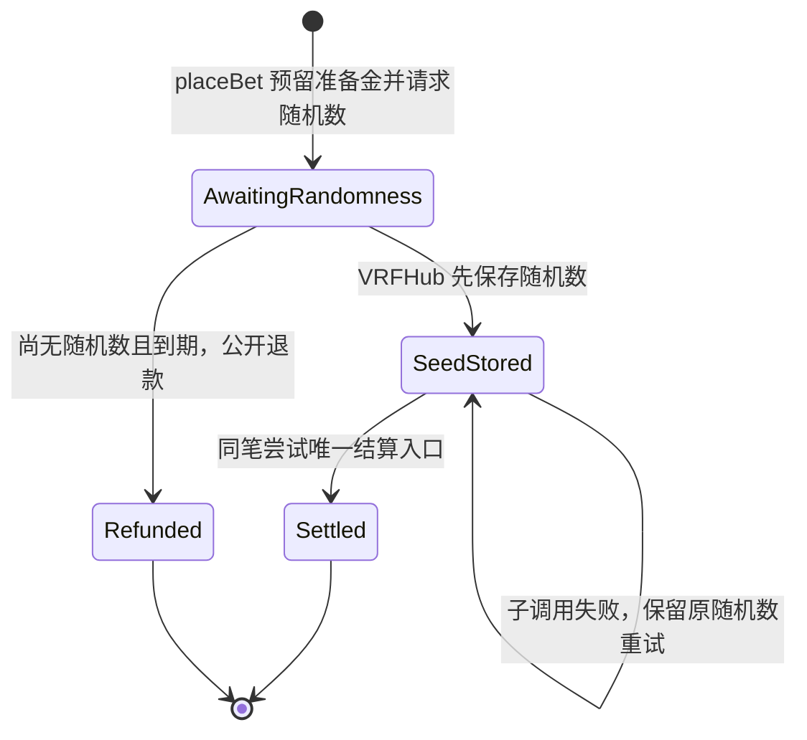

# ArbiGameFi 技术白皮书

> AGF-WP-TECH-2026.10-r3 · 2026-10-04 · 中文，附英文摘要 · 内部审阅稿，尚未对外发布
>
> **首要读者**：协议研究者、技术尽调与审计人员、集成方、专业 LP 的技术顾问
>
> **适用范围与状态**：本文描述已接受的 NFT 流动性与回调结算设计。核心合约及 SDK、Earn、keeper 接入已实现并完成对应版本的本地验证，详见[核心复盘](audit/nft-core-integration-review.md)和[应用复核](audit/nft-consumer-integration-review.md)。完整回调 gas 资格、新部署网络验收和外部审计尚未完成；此前端到端结果不代表后续源码已重新全跑。项目尚未正式上线。具体账本、接口与实施步骤见[实施设计](design/lp-accounting-and-callback-implementation.md)，新部署验收见[测试网清单](deploy/v16-sepolia-acceptance.md)。规范以 [SSOT v1.6](constitution/SSOT.v1.6.md) 与[可执行规范](constitution/ExecutableSSOT.v1.6.md)为准。

## 摘要

ArbiGameFi 是钱包原生的 casino 与 sportsbook 项目。每个资金池（Bank）为一种资产的投注提供赔付资本，资本来自 LP。本文回答技术尽调关心的五个问题：资金与权利归谁，规则如何冻结，结果与支付如何核对，外部依赖失败时责任怎样限定，以及治理能做什么、不能做什么。

主要结论如下：

- **每笔投注在接受时锁定规则与最大赔付。** 结算只能在这笔准备金以内完成，所有负债在形成时就从资金池净值中扣除。
- **LP 预算固定为每笔流水 house edge 的一半。** 分配比例是合约常量，推荐奖励与协议费用只能从另一半里支付，由结算路由器独立限额。
- **存款按 NFT 独立记账。** 每次入金生成新 NFT，固定锁定 24 小时；到期且自由资本足够时，提款同笔到账。部分提款成功后余款重新锁定 24 小时，转让 NFT 不重置期限。退出部分不再参与后续盈亏；正常提款不设置停注流程。
- **合约不可升级。** 治理可以暂停新风险、准入玩法与资金池，并在合约上限内调参，但不能任意提取 LP 资金，已接受投注的模块、有效 edge 与推荐比例版本固定；退款截止时间在接受投注时固定；治理调整仅影响新投注，默认 1 小时、范围 1 分钟至 1 天。

## 1. 设计问题与目标

LP 共同承保的链上 casino 同时面对四个相互牵连的问题。

1. **偿付**：每笔已接受的投注在最坏结果下都必须付得出。协议费用、推荐奖励和支付失败的玩家款项都是负债，不能重复计算，也不能被用来承保新的风险。
2. **投注期间的资金归属与排序**：未结投注本金不能当作 LP 利润。随机结果已记录但尚未入账时，LP 资金变动受门禁保护；结果记录前，成熟资本的退出和后入资金的回退分配仍可能改变参与者的盈亏。项目已明确接受并保留这一经济取舍，详见 §5.4；不承诺资本排序公平。
3. **持续运营与失败边界**：正常 LP 退出不能设置计划性停注。未结风险占用准备金；已记录随机结果却未入账时，该池 LP 操作暂缓，避免按已知过时价格进出。结算永久失败的可用性风险必须如实披露，不能承诺任何时候都能全额退出。
4. **可核对**：每个结果、费用与支付都必须能够仅凭链上数据重算。

| 目标                | 设计                                                | 章节   |
| ------------------- | --------------------------------------------------- | ------ |
| G1 偿付             | Bank 本金与负债、Vault 树资本分开；最大赔付与净锁定 | §3、§6 |
| G2 LP 分配比例固定  | 50% 为合约常量，路由器按开仓记录独立限额            | §4     |
| G3 清楚的退出权利   | NFT 24 小时锁定，退出部分无后续盈亏或回收权         | §5     |
| G4 持续下注         | 退出不设排空期；资本和风控条件仍限制接注            | §5     |
| G5 支付不能阻断记账 | 支付失败转为玩家应付款，仓位照常终结                | §6     |
| G6 可核对           | 事件与视图重算结果、分配、权益和现金流              | §10    |

本设计明确不提供：合约升级；跨资金池互相赔付；LP 在确定期限内全额取回现金的保证；当前阶段的体育资金池准入。

## 2. 系统结构

| 组件                                 | 职责                                                                              | 信任性质                                     |
| ------------------------------------ | --------------------------------------------------------------------------------- | -------------------------------------------- |
| Bank                                 | 托管投注本金与负债，记录准备金及每仓旧存款截止 ID                                 | 只接受认证 Router 的下注与终结调用           |
| LiquidityVault                       | 托管 LP 资本，ERC-721 存款、LiquidityTree、24 小时提款锁定                        | 固定绑定 Bank；NFT owner 提款并收款          |
| SettlementRouter                     | 把头寸绑定到原始 hub、资金池、Bank 与玩家；校验终态身份、次数与金额；执行分配上限 | 无治理函数，装配后不可更改                   |
| PoolRegistry                         | 定义资金池与业务域，授予 hub 使用指定资金池的准入                                 | 治理控制                                     |
| GameHub                              | 固定投注输入，请求随机数，调用游戏模块计算结果，按规则分配 house edge             | 治理可登记游戏模块、调整参数（有上限与延迟） |
| VRFHub（Chainlink wrapper consumer） | 直接请求 wrapper，先保存随机数，再同笔尝试 GameHub 结算；处理随机数费用退款       | 依赖 Chainlink VRF                           |
| 游戏模块（8 种）                     | 确定性规则：Dice、Coin Toss、Roulette、Keno、Plinko、Sic Bo、Slots、Baccarat      | 模块正确性属于安全假设                       |
| ReferralRegistry 与分配引擎          | 首次绑定的推荐关系；把运营预算分配给返水、推荐与协议                              | 推荐关系在接受投注时固定                     |
| SportsHub 与 SportsRiskEngine        | 体育固定赔率票据、敞口、结果证据与争议                                            | **当前不准入首发 casino Bank**               |
| Keeper（链下）                       | 异常补结算、超时退款、玩家应付款重试，以及 WS 事件和 HTTP 补漏                    | 所调用的函数任何人都能调用；不托管资金       |

合约没有代理、`delegatecall` 或升级机制，部署后的规则即为最终规则。Bank 不判断开奖结果：已准入的 hub 与模块可以在每笔投注的准备金范围内提交任意结果。因此随机数链路、模块代码和准入流程都是资金安全模型的一部分（§8）。不同资产、casino 与体育分别承保，互不赔付。

下注授权的 spender 是对应的 GameHub 或 SportsHub；LP 入金授权的 spender 是 LiquidityVault。Hub 只从调用玩家收款，Router 将认证后的 Hub 作为 Bank 的付款方，两段转账均校验精确到账，失败全笔回滚。玩家给 Vault 的 LP 入金授权不能被已准入 Hub 用来扣下注本金。这不限制已准入 Hub 在自身仓位准备金范围内提交结算，准入治理风险仍然存在。

每个 Bank 按资产最小单位配置最低每轮下注额，GameHub 在链上检查每轮金额和轮数。USDC 每轮最低 0.01 USDC（10,000 单位），单仓最多 25 轮，总本金等于每轮金额乘以轮数：1 轮最低 0.01 USDC，25 轮最低 0.25 USDC；不另设单仓合计 1 USDC 的门槛。各游戏可设置更低的轮数上限，并须通过完整回调 gas 准入。其他资产须在部署时显式确认其每轮最低额。未结仓位容量按当前 Bank 规则检查；不再区分活跃与历史退出仓位。最低下注和及时结算降低容量占用成本，但不保证任何网络负载下都能接单。

目标结算流程如下。这是跨 VRFHub 与 GameHub 的概念状态图，不把 VRFHub 已保存随机数等同于 GameHub 子调用已经成功写入状态：



## 3. 账本与偿付

LP 与投注资金使用两个固定绑定的合约。LiquidityVault 托管 LP 资本，Bank 托管投注本金并记录玩家、协议与推荐债务。定义：

| 符号         | 权威来源与意义                                        |
| ------------ | ----------------------------------------------------- |
| L            | LiquidityTree 根节点金额：所有存款 NFT 的当前资本权益 |
| P            | Bank 中全部未终结投注的原始本金                       |
| R            | Bank 中全部未终结仓位的最大终结支出准备金             |
| K = R − P    | LP 资本被占用的净锁定额度                             |
| G = L + P    | 新下注偿付基数                                        |
| PF / XP / PP | Bank 的协议、推荐与玩家应付款，均不属于 NFT 资本      |

正常状态须满足 `R >= P`、`L >= K`，等价于 `G >= R`。P 已在 Bank 托管，不在 Vault 再锁一次本金。L 直接读取树，不能再用 Bank 或 Vault 的代币余额减几项负债反推，更不能把捐赠变成可分配的存款权益。两处实际余额、树与债务分别对账；超出账面要求的资产作为 surplus 诊断，不自动加树，也不新增提取 surplus 的接口。精确托管恒等式与跨合约资金动作以 [ADR-0034](adr/0034-nft-liquidity-deposits.md) 为准。

接受本金 S 时，Bank 的 P 增加 S，R 增加本笔准备金，L 不变，并记录 Vault 此时的 `lastDepositId`。终结成本 C 包含玩家净派彩、未使用本金退款及新增 PF、XP；相对原本金的差额 `S − C` 决定树的盈利或亏损。终结清除该笔 P、R，并只结转一次损益。玩家转账失败改记 PP，不再重复从树扣一次；纯全额退款不产生 LP 利润。

**下注风险缓冲。** 收到本次本金后，使用以下公式；新部署默认 `riskReserveBps=6000`，
即按此时的 G 保留 60%，现有准备金与新增准备金合计须满足同一约束：

```text
G_after = L + P_before + S
R_after = R_before + 本笔最大准备金
R_after + floor(G_after × riskReserveBps / 10000) <= G_after
```

`L = 0` 时拒绝新下注，即使仅用投注本金计算也可能满足某个赔率条件。SDK 和游戏页面使用同一 G、R 和整数取整，不能将 L 直接代入旧偿付公式。

**NFT 提款。** 成熟存款的可提款现金上界为：

```text
freeCapital = max(L − K, 0)
可提额度 = min(本 NFT 当前节点金额, freeCapital)
```

LP 提款不叠加 `withdrawalBufferBps`。该参数用于 PF/XP 领取，部署默认独立保持 1000 bps，
不得被消费者误当作 NFT 提款条件。实际执行还校验 NFT owner、24 小时期限、暂停、跨合约 busy、账实有效性及已记录随机结果状态。没有 ERC-4626 份额价格、虚拟偏移、四个标准 `max*` 或最后一份额保留规则。

**数值准入**：新增存款和开仓均限制 `G <= 2^108−1`，为原树含 `1e12` 精度的乘法提供边界；不能只限制L而忽略未结本金之后可能转成利润。原树懒更新节点和固定宽度整数仍需阶段0独立验证。

**资产准入假设**：精确到账、无转账税、无 rebase，失败转账不能先改余额再返回失败。USDC 发行方冻结或暂停仍可能妨碍支付，账本记录不保证任意发行方动作下都有可用现金。

## 4. House edge 与分配

金额按资产最小单位整数计算。设 S 为投注本金，Q 为未使用本金的退款，H 为按规则计算的毛派彩，h 为接受投注时固定的有效 edge（bps）：

```text
U = S − Q                       实际使用的流水
F = floor(H × h / 10000)        派彩手续费，留在本局游戏损益中
N = H − F                       玩家净派彩
E = floor(U × h / 10000)        流水 edge
O = floor(E / 2)                运营预算
LP 保留 = E − O
PF_new + XP_new ≤ O
```

- **LP 预算比例是常量。** `LP_SHARE_BPS = 5000`，治理不能修改。树仍有资本时，LP 损益按 §5 分配；树根为零时后来产生的正收益归协议资本，不为已退出 NFT 重建权利。
- **运营预算的用途。** 运营方用 O 支付玩家返水（L0）、两级推荐奖励（L1、L2），剩余部分计为协议费用。L0、L1、L2 合计不超过该笔 edge 的 35%。玩家没有推荐人时 L0 不发放，这部分与舍入余数都归协议。
- **路由器独立限额。** 结算路由器按开仓时记录的 edge 独立计算上限，不依赖 hub 自报的预算，并检查 `N ≤ H`、`Q ≤ S`、`H + Q ≤ 准备金`。
- **Bank 的第二道检查。** 玩家净派彩、退款、PF 与全部 XP 之和不得超过该笔准备金。由于准备金不低于本金、手续费按毛派彩计收，这条对 casino 的每一种结果都成立。
- **F 与 E 是两个计量基数。** 即使一局没有派彩，也会按 E 计提运营预算。纯退款不产生任何分配。

**演算（示例参数，非上线配置）。** 流水 1,000 USDC，有效 edge 2%，推荐比例按基础 edge 的 10% / 20% / 5% 计：

| 项目              | 有两级推荐人 | 无推荐人 |
| ----------------- | -----------: | -------: |
| 流水 edge E       |        20.00 |    20.00 |
| LP 保留 E − O     |        10.00 |    10.00 |
| 运营预算 O        |        10.00 |    10.00 |
| 其中 L0 / L1 / L2 |    2 / 4 / 1 |        0 |
| 其中协议费用      |         3.00 |    10.00 |

单局的资本变化为 `U − H + F − PF_new − XP_new`（未计出入金；按下述树分配和零资本规则入账）。在规则公平、毛派彩期望等于流水的假设下，LP 的理论期望约为流水 edge 的一半，即上例的 10 USDC。这不是本金收益率：有限样本可以亏损，停止条件会改变实际分布，不能据此推算年化收益。

**参数边界。** 每笔投注只有一个 house edge，不超过 5%；推荐关系不改变该价格。house edge 的所有调整要等待 7 天才生效，任何人都可在到期后激活。推荐收款人、推荐比例版本及 house edge 在接受投注时固定，之后的配置变化不追溯奖励金额。Bank 的领取流水门槛和新建 holdback 释放期限仍读取当前配置，既有有效释放计划不因新奖励延长。详见 [ADR-0032](adr/0032-fixed-lp-share-operator-funded-referrals.md)。

## 5. LP：存款 NFT、24 小时与树分配

### 5.1 每次入金生成新存款

`LiquidityVault.addDeposit(amount)` / `addDepositFor(owner, amount)` 接收资产、增加树资本并生成新的 ERC-721 存款 NFT。每次均为新节点，不能向旧 NFT 增资。存款拥有独立节点金额和 `withdrawAfter = 入金时间 + 24 小时`；本项目采用固定常量，不提供治理修改冷却期或升级 Vault 的路径。

入金资产授权给 Vault，下注仍授权给对应 Hub。NFT 可以转让，转让后沿用原 `withdrawAfter`，不重新开始或绕过锁定。实际付款者、初始 NFT owner 和现 owner 可以不同，现金历史与权益归属必须分开记录。

### 5.2 提款规则

`withdrawDeposit(id, percent)` 只能由当前 NFT owner 发起，资产也只付给该 owner。成熟后按节点金额的指定比例提款，`1e12 = 100%`，并校验 §3 的自由资本条件：

- 部分提款成功后，剩余 NFT 重新锁定 24 小时。
- 100% 提款销毁 NFT；已经到期的零余额 NFT 也可通过此操作销毁。
- 0% 及向下取整为零的部分提款拒绝，失败交易不重置锁定时间。
- NFT 的 approved/operator 不能直接代提款，但能转走 NFT，再成为 owner。因此 NFT 授权仍是经济权限；官方入金／提款流程不请求 NFT approval 或 keeper operator 授权。

不设每日退出队列、旧风险凭证或领取阶段。提款成功立即减少 L 并转账；已退出资本不再分配后续盈亏。有未结仓位时也没有“最后一个 NFT 不能退出”的附加规则：当 `K = 0` 时，即使仍有未结投注，也可在其他条件允许时全部退出。

### 5.3 旧存款范围与盈亏

Bank 开仓时保存 `lastDepositId`，作为该笔未来结果优先分配的旧存款范围截止点。采用的树规则是：

1. 每次结算按该仓位原始最大 LP 亏损 `k = 最大总赔付准备金 − 原始本金` 选择分配范围，不使用当笔实际盈亏作为阈值。
2. 旧范围当前资本大于或等于 k 时，利润和亏损都分配给旧范围；小于 k 时，利润和亏损都分配给当前全树。因此后入存款可能同时承接旧投注的收益与风险，不能只将亏损转给它们。
3. k 为零时保留旧范围及原树空范围回退规则；此时不可能产生 LP 净亏损。分配范围在各笔结算时判断，先结算的结果可能改变后续仓位的范围与各 NFT 余额，不保证结算顺序无关。
4. 若结算时全树 `L = 0`，正收益归协议资本并单独记录；不把收益留在空根，也不给已经销毁或清空的存款补发权利。

这是针对 H-1“薄前缀独占利润、损失外溢”的统一分配修复，不是所有经济风险消失的证明。收益预期和风险都会随范围变化重新分配。因此不能用一个统一 ERC-20 价格来概括每个 NFT 的收益，也不能宣传新存款绝不参与旧风险。节点权利随 NFT 转移，钱包转让不等于现金入金或已实现利润。继受人的 NFT 取得成本未知时，页面不能把历史原始入金当作继受人投入来编造收益率。

### 5.4 流动性与经济取舍

例：L=100、P=10、R=40，则 K=30、G=110，自由资本为70。成熟 NFT 在自身节点余额范围内可以提走70；提款后仍有L=30覆盖净锁定。若R=P，则K=0，可在成熟与状态条件允许时提空L；后续旧仓盈利在空树情况下归协议资本。

**已接受的排序风险（2026-10-04）**：随机结果尚未记录且其他检查允许时，成熟 NFT 可提走自由资本；已退出部分不再参与以后入账的旧投注损益，留存 LP 按剩余树与回退规则承担。旧范围为空或不足时，后入资金也可能获得旧利润或承担旧损失。项目 Owner 已明确接受并保留这一模型，这是风险接受，不是风险修复。24 小时锁定及结果记录后的门禁不消除记录前的条件排序优势，保留准备金也不保证不同存取顺序取得相同盈亏。本地条件见证不证明真实 VRF 可提前预测；不宣传资本排序公平。

**H-1 分配修正**：结算时旧范围资本至少覆盖该仓位原始最大 LP 亏损时，两侧结果都归旧范围；否则两侧都归当前全池（零风险仓位保留原空范围规则）。这修正了无需预知结果的薄前缀套利，不撤销上述信息排序风险披露，也不承诺只转移波动而不改变预期收益。

正常退出不设置停注或全池排空，但资本减少会降低下注上限，L=0拒绝新注。未结仓位卡住会占用K；已经记录随机数但无法完成记账时，LP入金与提款暂缓。不能承诺所有NFT在固定时间内都能兑付。未知结算错误、无效结果或gas不足均不能把合法赢家改成退款来释放资本。

## 6. 投注结算与支付

- **接受**：规则参数最多 64 字节；最大轮数须由阶段 0 的完整回调与树操作 gas 测量确认，不超过合约硬上限 25 轮。准备金取模块给出的最大赔付，且不低于本金；按 §3 的 G 和现有风险比例检查。下注接受时固定退款截止时间。
- **随机数请求**：VRFHub 直接使用 Chainlink VRF v2.5 wrapper consumer 基础设施，不保留独立 adapter 或无 adapter 的生产合成报价分支。报价调用 wrapper；玩家以原生资产支付请求与回调所需费用，多付部分直接退还，失败时记为独立的原生资产退款额度。
- **正常回调**：先在 VRFHub 保存请求对应的随机数，再在同笔交易内尝试 GameHub 的唯一结算实现。正常完成后，本金、派彩、费用、NFT节点权益与准备金同时更新；不需要 keeper 再发一笔常规结算交易。
- **失败重试**：GameHub 子调用失败不抹掉已经保存的原随机数。任何人或 keeper 可以使用同一个请求、同一个随机数重试，不能重新抽取随机数。模块 revert、无效结果、Router 失败或 gas 不足都保留原仓位与结果，不转换为全额退款；合法玩法结果中的未使用本金退款仍属于正常结算。
- **已知结果保护**：随机数已经记录、损益尚未入账时，相关 Vault 的入金与提款暂缓；自定义存款可用性视图显示不可执行，先补结算再进出。权威检查沿 Vault → Bank（pause／busy／valid）→ Router → VRF，失败读不能默认放行。该保护不是每日排空，不主动停止新下注。回调成功时没有跨交易的已知结果等待阶段。
- **永久失败边界**：如果合约缺陷使已接收的结果始终无法结算，该池 LP 门禁会持续生效。公开同 seed 重试不是成功保证；当前接口不提供强制退款、抹账或绕过门禁提款。已得到结果的合法赢家不能为解除门禁而改成退款。此处披露可用性限制，不代表已发现可触发该故障的攻击。
- **gas 与排序边界**：采用 40 层 LiquidityTree、最多 25 轮，已有实际 wrapper fork 的完整回调样例；所有允许输入与历史状态的预算资格尚未完成。资格须覆盖旧范围与全树回退、模块计算、Router／Bank／Vault、支付失败以及保留随机数的外层 gas。回调同笔结算不消除 fulfillment 上链前的条件排序优势；项目已按 §5.4 接受并披露该经济风险，不把这一裁决作为 gas、部署或外部审计资格完成的证明。
- **超时退款**：仅在仍等待随机数且已达到开仓时固定的退款截止时间后，任何人可触发；默认 1 小时。已取得结果的有效赢家不能被后续超时变成退款。
- **支付与玩家应付款**：Bank 先尝试支付给玩家，拒绝转账时记为玩家应付款 PP，仓位可正常终结。`claimPlayerPayable` 任何人都能触发，暂停期间可执行，但只付给玩家本人；失败时债务保留。成功转账与新增债务互斥，不重复扣账。Keeper 保留重试与退避。
- **暂停**：阻止新风险和 LP 进出，以及协议费用、推荐奖励的可选领取；不阻止既有投注结算、退款或玩家应付款领取。
- **事件与收据**：正常回调中的 `BetRandomReady` 与 `BetFinalized` 可以同笔出现。订阅乱序、重复和 HTTP 补漏不得使终态倒退。收据分别证明结果与实际付款／应付款；后续代领不能改写当时的支付事实。

## 7. 失败模式与责任边界

| 事件                     | 直接影响                    | 设计处理                                       | 残余风险                                   |
| ------------------------ | --------------------------- | ---------------------------------------------- | ------------------------------------------ |
| VRF 未提供随机数         | 投注等待，准备金占用        | 固定截止时间后公开退款                         | 依赖有人提交交易                           |
| 回调尝试结算失败         | 原随机数已记录，损益未入账  | 同 seed 公开重试；该池 LP 操作暂缓             | 可能长期不可退出；gas 和失败隔离待验证     |
| Keeper 停机              | 异常补结算、退款与代领延迟  | 正常回调不依赖 keeper；公开函数与 WS/HTTP 补漏 | 仍需有人处理失败路径                       |
| 玩家被冻结或代币暂停     | 玩家不能立即收款            | 记为玩家应付款；失败重试不抹债务               | 解冻前不能保证支付；全局暂停也阻止 LP 转账 |
| 永久无法结算             | 净锁定K占用自由资本         | 保留仓位与原权利，不把赢家强制退款             | 已记录结果时该池 LP 操作受限，无全退期限   |
| 结果记录前排序、知情进出 | 尚未入账风险可能留给剩余 LP | 保留既定进出及回退规则，明确接受并披露排序风险 | 不承诺资本排序公平；不代表真实 VRF 可预测  |
| LP 集中退出              | 可用资本减少                | 成熟NFT执行可支付比例；净锁定限制金额          | 最大下注下降；并非人人随时全退             |
| 恶意模块或 hub 准入      | 准备金内也可提交错误结果    | 多签准入、Router 限额、Bank 校验               | LP 仍信任准入流程和模块代码                |
| 治理密钥失陷             | 可暂停、准入、受限调参      | 多签和权限边界                                 | 间接损失仍可能发生                         |
| RPC、WS 或索引故障       | 页面或事件延迟              | 链上状态为准，HTTP 补漏、断线重连与重放        | 展示与异常处理延迟                         |

## 8. 治理与信任假设

| 合约           | 治理可以                                                                            | 限制                                                                                                                  |
| -------------- | ----------------------------------------------------------------------------------- | --------------------------------------------------------------------------------------------------------------------- |
| Bank           | 暂停／恢复新风险；设置下注风险缓冲、holdback 周期、解锁门槛、guardian；领取协议费用 | 缓冲不超过 100%；不能任意动用玩家和NFT权益对应资产                                                                    |
| LiquidityVault | 按固定Bank状态执行LP规则，不新增任意资金处置能力                                    | 24小时为固定常量；无升级、无surplus提款接口                                                                           |
| GameHub        | 登记游戏模块；排队或取消 edge 调整；切换推荐比例版本；设置超时退款时间              | 每个游戏 ID 只能登记一次，不能更换或注销；edge ≤ 5%，调整 7 天后生效；新单超时 1 分钟至 1 天，默认 1 小时；推荐 ≤ 35% |
| PoolRegistry   | 登记资金池；启停资金池；登记 hub 并授予资金池准入                                   | 停用不影响已有投注的结算                                                                                              |
| VRFHub         | 请求参数与 wrapper 依赖按最终部署规范校验                                           | 不更换已接受请求的随机数，不保留独立适配器切换路径                                                                    |

- **guardian**：可以触发 Bank 暂停（包括新风险、存入及同步 LP 出金，具体见 §6），不能恢复，也不能移动资金或修改其他参数；恢复只能由治理执行。
- **治理不能做的事**：升级合约、提取 LP 资金、修改 LP 的 50% 分配比例、改写已接受投注的模块、有效 edge 与推荐比例版本、通过支付失败抹除玩家债务。
- **退款截止时间固定**：接受投注时保存截止时间，治理修改只作用于之后的新投注；默认 1 小时，上限 1 天。
- **准入即时生效**：登记游戏模块、hub 与资金池没有时间锁。这是 LP 需要信任的核心治理权限，上线前应评估为准入增加延迟。
- **外部 LP 准入前待决**：明确模块、hub 和池准入变更是否采用时间锁及其紧急禁用权限；收款权限隔离不能代替准入治理。Guardian 应采用与治理独立的多签，并实测发现到暂停、治理撤换 guardian 到解除暂停的耗时及旧 guardian 失权。
- **代币发行方风险**：发行方可能冻结、没收或销毁 Bank或Vault的底层资产，使资产不足以覆盖账面负债。应付款记录不保证有足够现金，也不绕开发行方限制；收费转账及 rebasing 资产不受支持。
- **外部依赖**：代币发行方、Chainlink VRF、链与 RPC 的可用性，以及有人愿意支付推进交易的 gas。
- **Keeper**：只推进公开状态，不决定结果，不持有用户授权，也不托管资金。

## 9. 体育的边界

体育规划为赛前固定赔率单关，使用独立资本。票据固定赔率、市场版本、期限、nonce 与风险参数；签名只证明报价来源，不证明现实结果。数据来源、报告门槛、挑战、裁决与作废规则都需要独立验证。体育投注在缺少结果或长期争议时的终结期限尚未完成，在此之前不准入这些 Bank，也不能把 VRF 的恢复规则直接套用到体育。详见[体育路线](strategy/sportsbook-production-roadmap.md)。

## 10. 实现状态与核对方法

**本次状态：核心和消费者已实现并完成对应版本的本地验证，发布资格待完成。** Bank/Vault 双托管、NFT 树账本与提款、VRF 回调结算及 SDK、页面、keeper 已接通。后续改动须重新绑定源件验证，不能复用旧版端到端结果冒充最终验收。详细顺序和完整验收矩阵见[实施设计](design/lp-accounting-and-callback-implementation.md)。

当前合约的实现和验证范围见[核心复盘](audit/nft-core-integration-review.md)，消费者见[应用复核](audit/nft-consumer-integration-review.md)，发布义务见[审计范围](audit/v1.6-audit-scope.md)。全新部署须固定源码、编译与部署身份，并按[测试网清单](deploy/v16-sepolia-acceptance.md)完成网络验收与外部审计。

**独立核对**：

1. 固定链、区块、发布身份、Bank、Hub 与资产，分别读取Bank／Vault余额、PF、XP、PP、P、R、树根L和NFT节点；核对G、K、旧范围分配、托管需求和surplus，不能靠代币余额伪造树权益。
2. 用原请求随机数、规则输入和分配事件重算结果；证明重复回调、异常补结算和超时竞态均不重复派彩，不重新抽随机数。
3. LP现金流水以Vault每NFT的入金／提款事件为准；ERC-721 Transfer单独记录所有权，不算现金入金。成功提款立即降低节点与树资本，没有待激活或待领取权益。费用、玩家债务与投注本金不能混入 LP 收益。
4. 覆盖新存款节点、比例舍入、24小时与转让、旧范围不足回退、空树利润归属、未结本金套利反例、NFT全额销毁、同笔多事件、重组、支付失败、最大轮数 gas、keeper 竞态和 WS/HTTP 补漏。正常回调通过不证明上链前排序公平。
5. 外部 LP 材料须披露 §5.4 已接受的排序风险，并另外核验 wrapper 实际 gas 限额、完整集成和独立审计；风险接受不替代这些资格，测试未执行或跳过时如实记录。

## 11. 术语

| 术语           | 含义                                                    |
| -------------- | ------------------------------------------------------- |
| LiquidityVault | 固定绑定Bank的LP资产托管、ERC-721与树账本合约           |
| L              | LiquidityTree根节点资本；不是统一份额价格或代币余额推算 |
| P／R           | Bank中未结本金／最大终结支出准备金                      |
| K／G           | 净锁定R−P／下注偿付基数L+P                              |
| 存款NFT        | 某次入金节点及当前、未来树分配权利；随ERC-721转让       |
| withdrawAfter  | 本NFT到期时间；入金和部分提款成功后加24小时，转让保持   |
| 旧范围截止ID   | 开仓时的lastDepositId，用于以后盈利／亏损的优先分配范围 |
| 玩家应付款PP   | 支付失败保留的债务，只能付给玩家本人                    |
| surplus        | 实际余额超出账本需求的独立诊断项，不自动增加树          |

## English abstract

**Core and application interfaces implemented; local integration verified, release qualification pending, 2026-10-04.** A separate LiquidityVault
holds LP capital and issues one ERC-721 deposit NFT for each addition. Bank retains bettor principal
and liability accounting. The tree root L is LP capital; net lock is `K = R - P` and betting solvency
basis is `G = L + P`. There is no fungible share price, virtual offset or ERC-4626 API.

Every new NFT has a fixed 24-hour lock. Mature owner-only withdrawal pays the owner; a successful
partial withdrawal relocks its remainder for 24 hours, while a full withdrawal burns the NFT.
Transfers preserve maturity. NFT approvals can move ownership and remain economic permissions;
the official withdrawal flow requests none. The cash cap is `min(nodeValue, max(L-K,0))`, without
an additional LP buffer. Open bets do not impose a last-NFT guard when K is zero.

Each bet snapshots the last deposit ID and maximum LP loss k=reserve-stake. At settlement, both profit
and loss go to that prefix when its current capital covers k, otherwise to the current tree. This
selection does not use realized PnL. At k=0 the original cutoff/empty-prefix fallback remains. New
deposits may share old returns and risk; earlier settlements can change later allocation. If the tree is empty,
subsequent profit belongs to protocol capital. Withdrawn capital has no future recovery right.

VRFHub directly consumes the wrapper, stores the original seed and attempts one settlement path.
Failures, including invalid results, retain the seed for public retry rather than refund or redraw.
Recorded-but-unbooked results block Vault cash operations. Keeper preserves exception handling and
WS/HTTP replay. The cap is 25 rounds; measured wrapper-fork examples do not qualify every permitted
input or lifetime history of the forty-level tree. Earlier 100-round or deployed-candidate evidence
does not validate this path. Before canonical result receipt, mature free capital may exit and bears
no subsequently booked outcome; remaining LPs and whole-tree fallbacks absorb it. The project Owner
explicitly accepted and retained these economics on 2026-10-04. The 24-hour lock and Received gate
do not eliminate this conditional ordering advantage. This is risk acceptance, not a fix or proof
that real VRF can be predicted; capital-ordering fairness is not promised. Full gas qualification,
final-source integration, fresh network acceptance and independent audit remain release gates.
